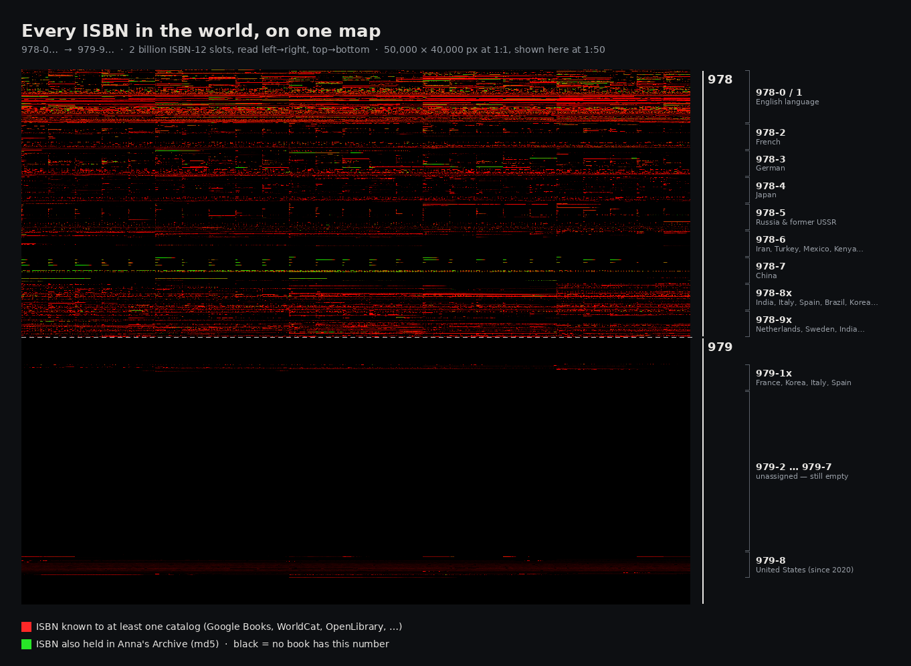
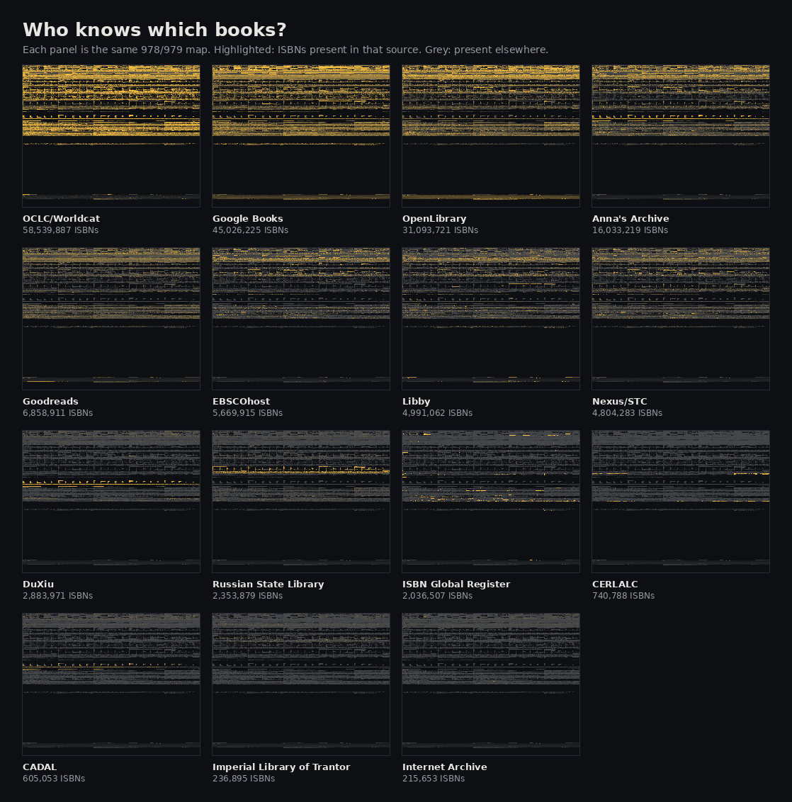
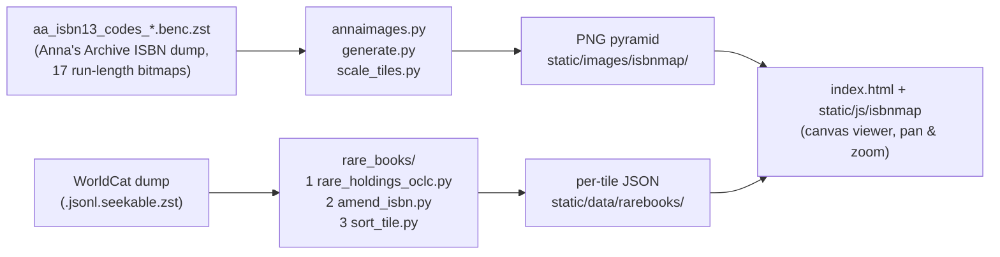

# Book Universe: an ISBN map

An interactive, zoomable map of **every possible ISBN**, the whole `978-` and `979-` space, with each book that has been assigned a number lit up where it sits.

**▶ Live demo: [immartian.github.io/bookuniverse](https://immartian.github.io/bookuniverse/)**

[](https://immartian.github.io/bookuniverse/)

## How to read the map

An ISBN-13 is a 3-digit prefix (`978`/`979`), 9 digits that identify the group, publisher and title, and a final check digit. The check digit adds no information, so the map drops it and treats the first 12 digits as one long number line:

```
offset = isbn12 − 978000000000        # 0 … 1,999,999,999
x      = offset mod 50,000
y      = offset div 50,000            # 978 → rows 0–19,999 · 979 → rows 20,000–39,999
```

At full zoom that gives a **50,000 × 40,000 px** canvas where one pixel is one ISBN. The number line wraps left→right, top→bottom, so each registration group (a language or country) shows up as a horizontal band. Inside a band, the large blocks are publisher ranges.

A few things stand out:

- **978-0/1 (English)** is the brightest strip: it holds the most catalogued books by far.
- **978-7 (China)** has a regular comb of short dashes, one for each publisher allocation.
- The **979 half is almost empty**. Only 979-1x (France, Korea, Italy, Spain) and 979-8 (the US, since 2020) are in use so far.

## Who knows which books?

The data merges 15 catalogs. Each catalog covers a different part of the map, and regional catalogs light up their own bands: DuXiu and CADAL light up China, the Russian State Library lights up 978-5, and CERLALC lights up Latin America.



The full 1:50 overview of each source is in [`static/images/isbnmap/1_50/`](static/images/isbnmap/1_50/), and the counts are in [`static/data/all_books.json`](static/data/all_books.json).

## Zoom levels

The viewer works like a slippy map. It shows the single overview image first, then switches to pre-rendered tiles as you zoom in:

| Zoom | Image(s) | Size | Path |
|------|----------|------|------|
| 1:50 | 1 image | 1000 × 800 | `static/images/isbnmap/1_50/` |
| 1:25 | 1 image | 2000 × 1600 | `static/images/isbnmap/1_25/` |
| 1:10 | 1 image | 5000 × 4000 | `static/images/isbnmap/1_10/` |
| 1:5 | 10 × 10 tiles | 1000 × 800 each | `static/images/isbnmap/1_5/` |
| 1:1 | 50 × 50 tiles | 1000 × 800 each | `static/images/isbnmap/1_1/` |

At 1:1 the overlay layer adds 🎗️ markers for likely **rare books**: WorldCat records held by fewer than 11 libraries. These come from per-tile JSON in [`static/data/rarebooks/`](static/data/rarebooks/). The viewer also shows a hover card for each book.

## Pipeline



Everything the viewer needs is pre-rendered and static, so the site runs on GitHub Pages with no backend.

## Run it locally

```bash
python3 -m http.server 8000     # from the repo root, then open http://localhost:8000
```

To rebuild the images, get `aa_isbn13_codes_20241204T185335Z.benc.zst` from Anna's Archive ([`aa_derived_mirror_metadata` → `codes_benc`](https://annas-archive.org/torrents#aa_derived_mirror_metadata)) and put it in `tools/`. Then run:

```bash
cd tools && pip install -r requirements.txt
python annaimages.py            # 1:50 overview images, one per source
python generate.py              # 1:1 tiles
python scale_tiles.py           # intermediate zoom tiles
python readme_figures.py        # the two figures in this README
```

The rare-book pipeline is documented in [`tools/rare_books/README.md`](tools/rare_books/README.md).

## Known limits: one ISBN, many books

ISBNs are not unique in practice. Publishers reuse numbers, and reprints sometimes get new ones. Even the very first ISBN in the space, `978-000000000-2`, is attached to several unrelated titles:


The map currently shows one book per position. Untangling these collisions is future work.

## Repository layout

```
index.html                 viewer page (served by GitHub Pages)
static/js/isbnmap/         View, TileManager, RarebookManager, ISBN helpers
static/images/isbnmap/     image pyramid, 1:50 → 1:1
static/data/               source counts + rare-book tiles
tools/                     data → image/JSON generators
test/                      prototypes (earlier multi-view version in test/isbnmapv1)
docs/                      README figures
```

## Credits

The ISBN data comes from [Anna's Archive](https://annas-archive.org/), which aggregates Google Books, WorldCat/OCLC, OpenLibrary, ISBNdb, Goodreads, EBSCOhost, Libby, Nexus/STC, DuXiu, the Russian State Library, the ISBN Global Register, CERLALC, CADAL, the Imperial Library of Trantor and the Internet Archive.
